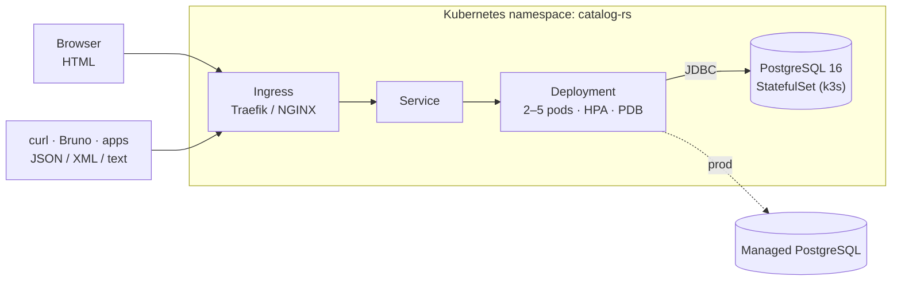
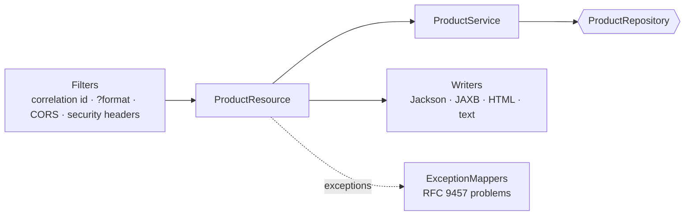

# Product Catalog – REST API (JAX-RS)


A production-style **REST API** for a product catalog: CRUD, keyword search, filtering, sorting and pagination,
built with **JAX-RS (Jersey 3)** on an embedded Grizzly server. **Every response is available as JSON, XML, HTML
or plain text** from the same URL. Data is stored in **PostgreSQL**, the API ships as a **Docker** image, and it's
deployed to **Kubernetes (k3s/k3d)** by **Jenkins**.

It's the REST twin of [`product-catalog-ws`](../product-catalog-ws) (SOAP/JAX-WS). Both share the same domain,
service and repository code, so the two web-service styles can be compared side by side.

---

## Highlights

| Area | What you get |
|---|---|
| **Resources** | `/api/v1/products`: GET (search), POST, GET/PUT/PATCH/DELETE by id |
| **Content negotiation** | JSON · XML · HTML (browsable, with search form and paging) · text. `Accept` or `?format=` |
| **Search & paging** | `q`, `category`, `minPrice`, `maxPrice`, `inStock`, `sort=price,desc`; `Link` + `X-Total-Count`; size capped at 100 |
| **HTTP done right** | 201 + Location · 204 · ETag + `If-None-Match` → 304 · `If-Match` → 412 · merge-patch · 405/406/415 |
| **Errors** | RFC 9457 problem details (JSON/XML/HTML/text) with stable `errorCode` + `traceId` |
| **Docs** | OpenAPI 3 at `/openapi.json`, plus a contract test that fails the build on unintended API changes |
| **Security** | Explicit-origin CORS, strict CSP for HTML, nosniff, safe correlation ids, no internals in errors |
| **Ops** | Health probes, graceful shutdown, non-root read-only container, HPA, PDB, NetworkPolicy |
| **Delivery** | Jenkins (as code): test → image → Trivy → deploy → smoke test → auto-rollback |
| **Testing** | Unit + HTTP ITs + Testcontainers + Bruno collection (129 tests) + smoke script |

---

## Architecture





---

## API at a glance

| Method | Path | Success | Typical errors |
|---|---|---|---|
| GET | `/api/v1/products?q=&category=&minPrice=&maxPrice=&inStock=&page=&size=&sort=` | 200 + `Link`, `X-Total-Count` | 400 |
| POST | `/api/v1/products` | 201 + `Location`, `ETag` | 400, 409, 415 |
| GET | `/api/v1/products/{id}` | 200 + `ETag` / 304 | 404 |
| PUT | `/api/v1/products/{id}` | 200 | 400, 404, 409, 412 |
| PATCH | `/api/v1/products/{id}` (merge patch) | 200 | 400, 404, 409, 412 |
| DELETE | `/api/v1/products/{id}` | 204 | 404, 412 |

<details>
<summary><b>One resource, four representations</b></summary>

```bash
curl -s localhost:8080/api/v1/products/1                            # JSON (default)
curl -s localhost:8080/api/v1/products/1 -H 'Accept: application/xml'
curl -s localhost:8080/api/v1/products/1 -H 'Accept: text/plain'
open http://localhost:8080/api/v1/products/1                         # HTML in the browser
```
```json
{"id":1,"sku":"ELEC-MOUSE-01","name":"Wireless Mouse","description":"2.4 GHz wireless optical mouse",
 "category":"Electronics","price":799.00,"stock":120,"createdAt":"2026-10-16T03:00:00Z","updatedAt":"2026-10-16T03:00:00Z"}
```
```text
Product 1
  sku:         ELEC-MOUSE-01
  name:        Wireless Mouse
  price:       799.00
  ...
```
</details>

<details>
<summary><b>Search with pagination</b></summary>

```http
GET /api/v1/products?category=electronics&inStock=true&sort=price,desc&size=3

HTTP/1.1 200 OK
X-Total-Count: 6
Link: <…?category=electronics&inStock=true&sort=price,desc&size=3&page=0>; rel="first",
      <…&page=1>; rel="next", <…&page=1>; rel="last"

{"items":[ …3 products… ],"page":0,"size":3,"totalElements":6,"totalPages":2,"hasNext":true,"hasPrevious":false}
```
</details>

<details>
<summary><b>Error (RFC 9457)</b></summary>

```json
{
  "type": "https://catalog.infy.com/problems/validation-failed",
  "title": "Validation failed",
  "status": 400,
  "detail": "The request has 2 invalid field(s); see errors.",
  "instance": "/api/v1/products",
  "errorCode": "VALIDATION_FAILED",
  "traceId": "3f1c2a7e-…",
  "errors": ["name is required", "price must be >= 0"]
}
```
</details>

---

## Quick start

```bash
mvn -B -ntp clean package -DskipTests
STORE_TYPE=memory SEED_DATA=true CORS_ALLOWED_ORIGINS=http://localhost:3000 java -jar target/product-catalog-rs.jar
```
Then:
- Browser: http://localhost:8080/api/v1/products
- Terminal: `curl -s 'localhost:8080/api/v1/products?size=5' -H 'Accept: text/plain'`
- Everything: `./scripts/smoke-test.sh http://localhost:8080` or the Bruno collection in `api-collections/`

With PostgreSQL: `docker compose up -d --build`. Kubernetes, Jenkins and production steps are in **[HOW_TO_RUN.md](HOW_TO_RUN.md)**.

---

## Testing

| Layer | Where | Runs |
|---|---|---|
| Unit | `src/test/java/**/*Test.java` | `mvn test` |
| HTTP integration | `ProductApiIT`, `OpenApiContractIT` | `mvn verify` |
| PostgreSQL | `JdbcProductRepositoryIT` (Testcontainers) | `mvn verify` with Docker |
| Black-box | `api-collections/bruno` (129 tests), `scripts/smoke-test.sh` | against any running instance; Jenkins runs the smoke test after deploy |

---

## Project layout

```
src/main/java/com/infy/catalog/
├── api/            JAX-RS: resources, DTOs, problems, mappers, renderers, filters, OpenAPI
├── service/        business rules, validation, paging policy        (shared with the SOAP project)
├── repository/     in-memory + JDBC (PostgreSQL)                    (shared)
├── domain/         records and domain exceptions                    (shared)
├── infra/          Hikari, Flyway, logging bridge
├── config/         typed env-var configuration
└── Application     ResourceConfig, Grizzly server, graceful shutdown
src/main/resources/db/        Flyway migrations + seed data
k8s/base, k8s/overlays/{k3s,prod}    Kustomize
infra/{k3d,k3s,jenkins}             cluster and CI setup
api-collections/ · http-samples/    Bruno collection, .http file
scripts/            smoke test, OpenAPI baseline
Dockerfile · docker-compose.yml · Jenkinsfile · Makefile
```

Contributing or using Claude Code? Read **[CLAUDE.md](CLAUDE.md)**.

## Tech stack

Java 21 · Jersey 3.1 (JAX-RS) · Grizzly · Jackson · JAXB · swagger-core (OpenAPI 3) · HikariCP · PostgreSQL 16 ·
Flyway · SLF4J/Logback · JUnit 5 · Testcontainers · JaCoCo · Docker · Kustomize · k3s/k3d · Traefik · Jenkins (JCasC) · Trivy · Bruno

## Roadmap

- [ ] OAuth2 / JWT authentication with per-endpoint authorization
- [ ] Atomic optimistic locking (version column)
- [ ] Micrometer + Prometheus metrics, rate limiting
- [ ] Spring Boot version of the same API (the next course module)
# product-catalog-rs
